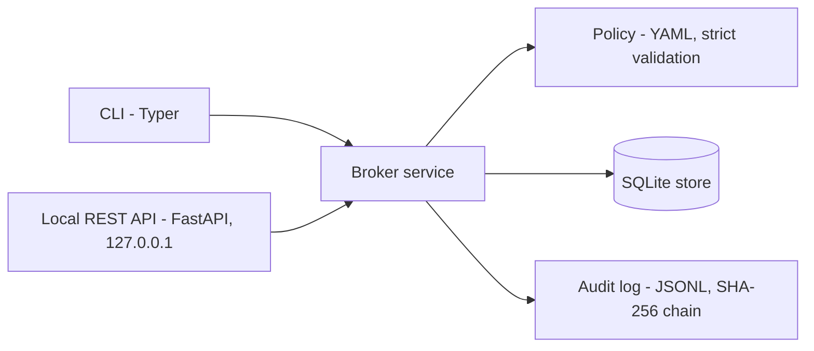
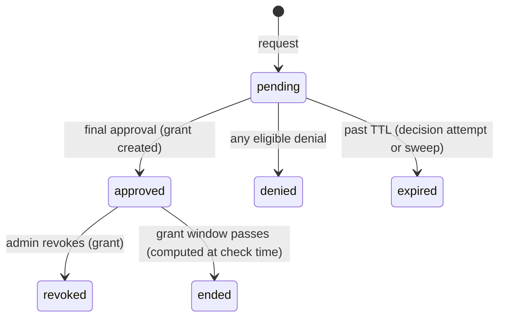

# Architecture

jit-access-broker is a small layered application. Every front-end (CLI, REST API) calls the same
`Broker` service, so security rules live in one place.

## Layers
| Module | Responsibility |
|---|---|
| `policy.py` | Load and strictly validate the YAML policy (users, roles, approvers, limits). |
| `domain.py` | Immutable models: requests, grants, access results. |
| `store.py` | The only module that talks to SQLite. Bound parameters, `BEGIN IMMEDIATE` transactions. |
| `audit.py` | Append-only, hash-chained JSON Lines log and its verifier. |
| `service.py` | Use cases: request, approve, deny, check, revoke, sweep. No printing. |
| `cli.py` | Translates commands into service calls. |
| `api.py` | Local REST API over the same service, with session login. |
| `auth.py` | Local accounts, Argon2id hashing, sessions and login throttling. |

## Request lifecycle

## Key design rules
- Deny by default: a role or user that is not listed in the policy gets nothing.
- Expiry and revocation are decided at check time inside a transaction, not by a background job.
- The audit log is written inside the database transaction (fail closed).
- Time comes from an injectable clock, so tests never wait. All timestamps are UTC.
- Time-bound access has no extension: more time means a new request that goes through the policy again.